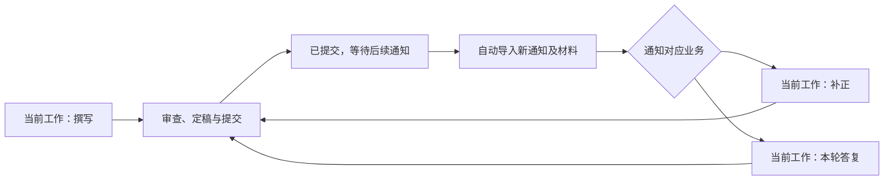

# 独立专利工作台需求基线

状态：2026-09-13 更新至 0.3.0。R-85 / R-86 新增撰写参考材料管理，R-87 确认三级版本规则；0.2.11 的统一对话与队列修复已保留。历史阶段的“尚未接入”不是当前状态，最新实现、验证与未完成项以 EXEC_PLAN.md 的 0.3.0 记录为准。

本文件是需求、用户回答和待决事项的唯一维护位置。旧会话建议、旧仓库实现与本项目已确认需求分别记录；未回答的问题不按默认选项确认。

## 产品定位与分期

面向用户自己工作的独立专利工作台，以案件为中心承载材料、任务、对话、稿件和成果。审查意见答复是首个完整流程；整体产品还包括后续撰写、独立审查和贝思兰德内部业务流转。

| 范围 | 定案 |
| --- | --- |
| 首版 | 完整案件管理与多轮答复，包含贝思兰德个人案件 / 新通知自动导入落盘、流程查询、唯一当前办理阶段、用户策略选择、直接编辑、独立 AI 复核、模板 Word 定稿和跨平台安装。贝思兰德读取侧为本轮纠正后纳入的案件管理范围。 |
| 后续明确目标 | 技术交底起步的专利撰写、可单独使用的申请文件审查、贝思兰德保存与内部转交。 |
| 交互设计 | 先做可交互原型，与用户调整；按整体工作台组织，首版实现答复。 |
| 后台 | 已实际对照并由用户确认 OpenCode，首版集成一个；产品完整验收继续。 |
| 模型 | DeepSeek 为主，支持自定义 API、Key 和模型。 |
| 平台 | macOS `.app` 和 Windows 可安装 / 双击启动的 `.exe` 程序，先在 Mac 验证；浏览器预览仅用于开发设计，不能替代桌面交付。 |

上述后续目标必须在设计与实施计划中保留，不要求首版把它们全部实现；不将后续集成扩展为向国家知识产权局正式递交。

## 已确认

| 编号 | 需求 | 确认来源 |
| --- | --- | --- |
| R-01 | 在本项目建立独立专利工作台，面向用户自己的专利工作；界面与流程围绕案件组织，整体不限于答复业务。 | 当前请求、第一轮回答、第九轮补充 |
| R-02 | 首个需要完整跑通的业务是审查意见答复：导入通知书、整理材料、下载对比文件、分析并生成答复文件。 | 第一轮回答 |
| R-03 | 支持 macOS 和 Windows，先在 Mac 验证。 | 第一轮回答 |
| R-04 | 自有应用封装可嵌入的后台 agent，Hermes / OpenCode 已进行实际对照；用户于本轮确认采用 OpenCode。 | 指定旧会话中的用户说明 |
| R-05 | 先读取旧会话及两个旧仓库，以多轮问答完整核对需求，再依据官方 GPT-6 指南建立项目规则。 | 当前请求 |
| R-06 | 导入、材料整理和下载按固定流程执行；用户人工确认后，点击“开始答复”才启动答复分析。 | 第二轮回答 |
| R-07 | 首版覆盖发明和实用新型，含首通、二通、后续审查意见及补正。不得用首通演示替代完整首版范围。 | 第二轮回答 |
| R-08 | 在应用内充分讨论和修改，用户点击“定稿”后再生成完整 Word 文件。 | 第二轮回答 |
| R-09 | 重新设计案件工作台，先提供可交互原型，再与用户一起调整。旧 DOM 看板不是必须原样保留的新项目约束。 | 第三轮回答 |
| R-10 | 点击“开始答复”后，先提供审查意见拆解和多种策略；用户选定策略后再起草。 | 第三轮回答 |
| R-11 | 原始申请文件库沿用现有目录并自动匹配材料。案件工作目录可以新建到用户选择的位置，新产物按案件和轮次保存；同一工作台目录支持在另一电脑读回。普通旧目录迁移不是本轮前提。 | 第三轮回答、2026-09-12 本轮澄清 |
| R-12 | 以 DSH 当前按通知类型组合的答复规则为准，再调整为新应用的讨论、起草与定稿流程。历史上要求主提示词全文不变的约束不直接沿用。 | 第四轮回答 |
| R-13 | 首版材料格式包括 PDF、扫描 PDF、图片、DOCX 和旧 DOC，覆盖附图、表格和公式。 | 第四轮回答 |
| R-14 | 定稿材料包括意见陈述书、补正表单字段记录，以及本次实际修改的权利要求或说明书 Word；修改依据和内部复核说明分别保存。补正说明不作为附件上传，按 R-84 执行。 | 第四轮回答 |
| R-15 | 期限提醒、搜索筛选、标签与归档、批量下载属于首版固定案件管理功能。批量通知导入已由 R-81 取消，以贝思兰德通知同步替代。 | 第五轮回答 |
| R-16 | 多个案件可同时运行，用户能随时停止；应用关闭重开后保留记录，由用户选择继续。同一案件只有一个当前办理阶段，不能将多案并行误写成同案多业务并行。 | 第五轮回答、2026-09-12 纠正 |
| R-17 | 每个答复轮次有独立对话，也能另开讨论；后续轮次按需引用历史材料和成果。 | 第五轮回答 |
| R-18 | 按已确认需求对照验证 Hermes 与 OpenCode，提供推荐后再确定；首版只集成一个后台 agent。 | 第六轮回答 |
| R-19 | 以 DeepSeek 为主，保留自定义 API 地址、Key 和模型配置能力。GPT-6 是开发规则的官方参考，不是已选定的产品模型。 | 第六轮回答 |
| R-20 | Agent 能读写本案文件、按需联网检索；用户可添加或调整技能及 MCP 工具。固定案件准备流程仍由应用执行。 | 第六轮回答 |
| R-21 | 用户既能直接编辑应用内正文，也能通过对话让 agent 修改；保留可回看的版本。 | 第七轮回答 |
| R-22 | macOS / Windows 使用现有共享目录或网盘同步案件，避免两台同时修改同一案件。 | 第七轮回答 |
| R-23 | 普通桌面应用式安装和启动，交付 macOS `.app`、Windows `.exe` 程序 / 安装包；后台 agent 及必要依赖随包提供或由应用自动配置，不要求用户运行开发服务器或打开浏览器使用。界面采用 Web 技术不改变桌面交付要求。 | 第七轮回答、2026-09-12 重申 |
| R-24 | 共享目录 / 网盘只同步案件材料和生成文件，对话及任务记录留在各自电脑。 | 第八轮回答 |
| R-25 | 定稿前必须由独立 AI 审查任务复核，给出问题后回到原对话修改。 | 第八轮回答 |
| R-26 | Word 必须沿用用户的既有模板，具体路径由用户提供。不能以通用版式或旧软件默认格式替代验收。 | 第八轮回答 |
| R-27 | 原件不覆盖，稿件修改保留版本。 | 第九轮确认 |
| R-28 | 固定准备流程失败时显示原因并可重试。固定流程不意味着忽略下载、匹配或文件异常。 | 第九轮确认 |
| R-29 | 材料缺失、未读范围须明确展示，引用能定位原文。 | 第九轮确认 |
| R-30 | 独立 AI 复核使用单独上下文，问题返回原对话处理，可再次复核；最终定稿权属于用户。 | 第九轮确认 |
| R-31 | 最小化后可继续运行；完全退出时保存记录并停止任务，重开后由用户选择继续。 | 第九轮确认 |
| R-32 | 升级由用户触发，保留案件、设置、对话、任务和已有成果数据。 | 第九轮确认，结合已确认的数据保存范围 |
| R-33 | 用户提供准确 Word 模板作为导出验收前置材料；现已提供并纠正，最终路径与结构见 R-62。 | 第九轮回答 |
| R-34 | 撰写、审查和贝思兰德保存 / 内部转交属于整体专利工作台的明确后续阶段；首版完整做好答复。该分期不覆盖本轮补齐的贝思兰德个人案件同步和流程查询，读取侧纳入案件管理。 | 第九轮补充、第十轮回答、2026-09-12 纠正 |
| R-35 | 后续撰写流程：技术交底 → 必要检索 → 方案讨论 → 完整申请文件 → 独立审查 → 修改与定稿。 | 第十一轮回答 |
| R-36 | 后续审查可单独导入已有申请文件，给出有原文依据的问题和修改建议。 | 第十一轮回答 |
| R-37 | 后续贝思兰德集成：把定稿文件和对应表单保存到系统，再提交给下一内部办理人；以 `0001` 项目的接入资料与工具为复用来源。 | 第九轮补充、第十一轮回答 |
| R-38 | 一个案件同一时间只有一个当前业务状态；先完成并提交当前工作，收到后续通知后再进入对应补正或答复。历史撰写、历次通知与答复可查看，不能同时成为可运行的当前业务。 | 2026-09-12 用户纠正及追答 |
| R-39 | 案件库接入贝思兰德，只自动同步分配给用户 / 由用户负责的案件；发现新案件、新审查意见或补正通知后自动导入并保存到本地案件目录，不要求逐份手工导入。 | 2026-09-12 用户纠正及同步范围回答 |
| R-40 | 能查询贝思兰德案件流程情况，包括当前业务、当前节点、办理人、期限、流转及历史记录；读取真实业务状态，不能用本地定稿或模拟回执代替系统结果。 | 2026-09-12 用户纠正 |
| R-41 | 在设置内登录、退出或切换贝思兰德账号，显示当前账号、姓名、机构与登录状态，供其他同事使用；账号的凭证、案件记录和目录设置相互隔离。 | 2026-09-12 用户授权修复及新增要求 |
| R-42 | 分别选择现有原始申请文件库与总工作文件夹；在后者按稳定规则为每个案件建立独立目录。原始库保留，自动复制匹配材料，具体目录与落盘方案由助手规划实施。 | 2026-09-12 用户新增要求 |

### 2026-09-12 目录保存补充

用户已成功登录，并反馈保存目录看似无反应。保存动作必须即时显示进行中、成功或具体失败原因，提示位于保存按钮附近；不能因后续目录读取或网络同步未完成而误称设置没有保存。允许先保存原始库、稍后再选择工作目录。用户先指定在“专利撰写目录”下新建工作文件夹，随后纠正原始库应为 `/Users/cyh/Documents/专利撰写目录/未完成`。最终两个根分别为“未完成”和“工作文件夹”，是同级目录；不再把父目录当作原始库。应用仍可安全支持工作子目录布局，原始扫描必须排除工作子树。

### 2026-09-12 案件库与流程新一轮核对

用户要求核对以下新增及纠正项。本节记录需求与待决口径，不代表实现完成。

| 编号 | 本轮明确要求 | 实施与验收口径 |
| --- | --- | --- |
| R-43 | 案件表格列宽可调整，修复当前状态与办理日期重叠。 | 表头边界可拖动，表头与数据列同步调整；保留合理最小宽度和横向滚动，长状态换行或截断并可查看全文；重开记住列宽。 |
| R-44 | 案件库顶部增加超期、临近等统计项。 | 统计以当前账号案件为范围；统计项可点击筛选。临近窗口已确认为 14 天；已归档、已完成和已确认递交官方的流程不纳入待办理期限提醒。 |
| R-45 | 官方期限优先，缺失时使用贝思兰德计算期限，始终不使用内部期限。 | 真正官方期限与 `CaseProcLegalDate` 分开保存，后者是贝思兰德计算日期；`CaseProcCustomDate` 不用于回退。列表、详情、排序、统计和提醒使用同一有效日期并标明来源；两者缺失显示未提供。本轮用户明确暂不接入 CPC，先使用贝思兰德期限。旧版误命名的 `officialDeadline` 迁移为贝思兰德日期，不能当作真实官方依据。本地日期另标自设日期，按本地自然日计算。 |
| R-46 | 点击表头切换排序，增加类型排序和筛选。 | 案件名称、专利类型、办理业务、当前状态及办理期限可点击表头排序，再次点击切换升降序，箭头标明方向；默认期限升序，缺失日期始终置后。移除独立排序下拉框，列宽拖动与排序互不干扰；支持键盘。专利类型与办理业务筛选仍可组合。 |
| R-47 | 官方递交后显示等待官方，而非继续显示内部办理人卡点。 | 采用新版字典与字段说明：`GetHandInfo.IsPackageSendSuccess` 为打包并发送成功的主要依据，`SendStatus` 区分待递交、准备、递交中、成功、失败和已收到回执。单独打包、内部转交、流程完结不证明官方递交；未知值不猜测。例案经用户确认仍在递交中，另以已完成案件只读验证成功状态。已递交 / 已收到回执时，实际当前阶段也必须切换为等待官方处理，不再保留活动撰写 / 答复入口；原办理业务用于分类，原稿和轮次留在历史，新通知到来再切换到对应阶段。旧记录重开也遵循此规则。“内部流程与承办人”保留原业务名称，但已递交 / 已收到回执的主业务标为已提交 / 最近已办业务，不再标“当前办理”；仅仍在内部办理的主业务保留当前标记。 |
| R-48 | 流程节点增加进度条。 | 按真实节点显示已完成、当前、后续节点及办理人、时间；已递交官方后当前位置移到官方等待阶段，内部办理人保留为历史。没有未来节点数据时只展示已知进度，不编造百分比或节点。 |
| R-49 | 审查意见、补正和申请用不同颜色区分。 | 使用独立业务标签；初步配色申请蓝、审查意见紫、补正橙，始终保留文字，逾期提示使用独立红色，避免业务类别与紧急程度混淆。 |

本轮追答已确认：

1. 类型排序 / 筛选同时包含“发明、实用新型等专利类型”和“申请、审查意见、补正等办理业务”。
2. 临近期限的默认窗口为 14 天；用户随后明确日期采用官方优先、贝思兰德计算日期兜底，适用于列表、详情、统计、排序和提醒。本轮暂不接入 CPC。
3. 例案 `202608282-1291` 已实际只读查询；用户随后澄清其仍在递交中，尚未递交官方。保留当前内部递交办理状态，不应提前转成等待官方。
4. 增加工作目录迁移功能，原始申请库不迁移。

### R-50 工作目录迁移

设置中可选择新的总工作目录，先预览源 / 目标、当前账号范围、案件和文件数量，再由用户开始迁移。复制当前账号的案件工作子树，包含原始申请副本、通知材料、工作稿、定稿及内部说明，保持案件标识和相对路径；不移动外部原始申请库，也不移动本机凭证 / 对话 / 任务 / 模型设置或其他账号的工作数据。

实现采用复制、校验、切换，原工作文件留作备份；新目录必须为空，不直接混并已有目录。迁移时暂停相关同步和写入；失败、中断或取消时旧目录继续有效。成功后只切换当前账号的工作根目录，退出重开后仍能访问迁移成果。实际迁移由用户在设置选择新目录并触发，本轮仅用隔离材料验证，不擅自迁移真实工作库。

### R-51 版本化构建与旧产物清理

每个交付 `.app` / `.exe` 文件名带明确版本与平台；应用内部版本与包版本一致。新版必须先构建并核验成功，再替换交付目录里的旧生成产物；构建失败保留旧版。构建命令应自动完成此过程，不仅手工清理一次。正式产物目录只保留当前版本交付物及校验清单，不保留 unpacked 中间目录；原件、案件目录及非构建文件不属于清理范围。

本轮采用的展示口径：顶部提供在办、已超期、今天到期、临近期限、等待官方；临近不与超期 / 今天重复计数。已归档、已完成和已确认递交官方的当前流程不计入待办理期限提醒。主要字段确认递交后显示“已递交，等待官方处理”；只得到 `SendStatus=2` 时显示递交成功并等待回执；`6` 明确标注已收到回执。当前内部节点优先使用 `CurrentFlowInfo` 和 `IsCurrentFlowNode`，已完成节点不因残留 `IsRunning` 被标为当前。不改变后续官方主动提交能力的范围，本轮仅查询状态。

## 已确认的主流程

### 2026-09-12 当前办理与 Agent 接入纠正

- R-52：当前办理依据当前真实业务及节点；内部显示正在办理的节点与办理人，递交官方后以官方作为当前办理主体。“收到回执”只证明接收成功，之后仍等待官方处理结果；不得把回执、内部结束或 `ProcStatusCode=500` 当作案件最终结束。后续通知 / 活跃流程到来后切换到对应当前办理，旧回执不能让新流程一律成为历史。无可靠结果证据时显示等待或待核验，不猜测授权 / 驳回等结果。
- R-53：本轮修复上述流程后进入真实 Agent 接入阶段。用户指定采用本机 DSH 中 OpenCode Go 的 DeepSeek V4.1 Flash（DSH 保存别名 `deepseek-flash`；本轮服务端清单及实调也确认正式 ID `deepseek-v4.1-flash`），优先沿用 Responses 协议并实测明确 v4.1 ID，保留必须的请求头；不因模型清单只列 Chat Completions 就静默切换，按会话独立、同会话稳定地设置 `x-opencode-session`。DSH 配置只读导入，产品设置支持独立配置；不要求其他同事安装 DSH。凭证仅本机接入层使用，不交给开发执行模型。
- R-54：Agent 模型配置支持自定义供应商名字、URL、Key、模型名称、上下文窗口、最大输出和协议类型，可从上游接口获取模型列表。支持多个供应商 / 模型及手动补充未返回的能力字段；真实调用遵循所选协议与限制。Key 单独加密保存在本机，获取模型和连接测试不把凭证回传前端或写入共享目录。
- R-55：自定义模型配置增加思考等级。按所选协议及模型实际支持能力列出档位，配置要进入真实请求；不支持或尚未核验的模型须明确显示，切换模型不沿用不兼容档位，不能把输出思考内容或 HTTP 成功单独当作等级有效的证据。
- 本轮已授权只读取得上述配置及真实模型联调。首版固定流程、材料确认、策略选择、独立复核和用户定稿等既有要求继续有效；不能以普通聊天输入框替代实际案件文件操作和任务恢复。

### 2026-09-11 原型设计补充

用户审阅第一版设计后明确要求：参考美观的成熟产品，界面需要明确层次，不能将案件列表、材料与任务流程平铺在一屏；设计必须实际考虑后续撰写与审查接入，不能仅用灰色入口占位。原型需重设计整体信息架构。此补充不改变首版完整交付答复、后续实现撰写/审查/贝思兰德的分期。

设计响应（待新版原型核对）：全局案件库 → 单案工作空间 → 具体业务任务；答复、撰写和审查共用案件材料、有效版本、成果及引用关系。用户已选择“浅色专业风格：参考 Linear、Craft，留白清楚、层级分明”。

2026-09-12 用户进一步授权：按照设计目标依次完成各项设计，由助手先自行视觉验收；未明确的小项按工程判断继续，不以等待设计确认阻碍开发，也不增加过严的结束指标。当前设计验收以层次清晰、主要操作可体验、无明显遮挡或溢出为准，仍区分原型演示与真实业务实现。

固定导入 / 整理 / 下载 → 人工确认 → 点击开始答复 → 意见拆解与策略讨论 → 用户选定策略 → 起草与多轮修改 → 独立 AI 复核 → 问题回原对话修改 → 用户点击定稿 → 按既有模板生成完整 Word 并归档本案轮次。

“开始答复”“选定策略”“定稿”是三个不同的用户动作。生成分析不代表策略已确定，生成草稿不代表已经定稿。

### 2026-09-12 桌面、生命周期与贝思兰德纠偏

本节优先于 v3 原型的模块平行设计，也优先于先前“自主设计验收完成”的结论。用户没有改变桌面应用目标；此前 Vite 页面仅为设计预览；本轮已采用 Electron 实施独立桌面程序，平台验证情况见实施计划。后续不能再用增加可点击页面来代表桌面交付进度。

**案件按业务生命周期前进。** 用户已指出：必须写完并提交，之后才可能收到补正或审查意见。不能把“未完成的撰写与新答复任意并行”作为日常产品模型，也不需要用户为这个错误前提选择切换策略。

示意顺序（业务类型、次数和实际节点以案件及贝思兰德数据为准，不把图示限定为必经固定次数）：

- 案件库以案件为单位，每案只显示一个当前业务及其步骤，例如“二通答复 · 起草中”。全局撰写 / 答复 / 补正入口是当前业务的筛选，不在每个入口重复展示全部案件为可开工状态。
- 案件详情围绕“当前办理、材料、历史、成果、贝思兰德流程”组织。历史阶段保留对话与版本，查看历史不切换当前业务，也不重新启动已结束流程。
- 独立复核可以是当前工作的一个步骤；单独导入文件进行审查时，审查本身是该案件的当前工作，不能另开同时进行的主业务。
- 本地保存、定稿、内部转交和正式提交分别记录；只有实际业务证据支持时才显示相应完成状态。接入已有案件时从贝思兰德当前阶段进入，不要求从撰写重新走一遍。
- 技术实现必须用案件级唯一当前工作引用管理阶段及关联流程 / 轮次，不能由撰写、答复、补正三个独立状态推测“哪个优先”。历史与当前存储分离，所有启动入口和任务调度统一检查该引用。

**贝思兰德读取侧纳入案件库。** 同步范围已明确为分配给用户 / 由用户负责的案件；不扩大到全部账号可访问案件。应用运行时自动检查，启动时补查，保留手动刷新；完全退出后的行为遵循 R-31，不新增未确认的常驻服务。具体检查频率按服务能力在实现时设置。

- 按远端稳定的案件 / 流程 / 文件标识关联本地材料，分页取全、重复同步不重复建案或覆盖旧稿；同名文件不作为唯一身份。
- 新案件建立本地案件目录；新通知和附件按对应案件 / 流程 / 轮次落盘。校验完成后才标为已导入；失败显示原因并可续传或重试，原件保留。
- 同步负责材料准备，不自动替用户启动 AI 分析、选择策略、定稿或提交。
- 流程页显示远端当前节点、办理人、期限、历史与最近查询时间。没有流转实例时显示实际的待办情况，不能把空记录解释为已完成。
- 账号、同步配置及凭证与共享案件材料分开。同步负责人的过滤字段和权限需要真实账号只读验证，不能从接口名直接认定范围正确。

**本轮核对的接口依据（尚非本项目联调结果）。** 已重新读取 `0001` 当前 `19fcfe8` 工作树内的准确文档；相关接入文档和工具仍有未提交内容，本项目没有修改该来源，也未使用真实账号请求。

| 需求 | 已有接入资料 | 本项目实现与验证目标 |
| --- | --- | --- |
| 个人案件与业务阶段 | `GetPersonalCase`，见 `接入文档/1-贝思兰德云API/2-只读-工作台与检索.md` | 按负责范围过滤、分页、以 `CaseId` 归并；接口按流程返回，不能每行建立一个重复案件。 |
| 流程与期限 | `GetCaseDetailProcList`、`GetProcFlowRecord`、`GetCaseAllFlowHistoryInfo`，见第 3、4 节 | 当前流程映射、节点 / 办理人 / 历史读取、真实状态及时间展示。 |
| 通知及附件落盘 | `GetCaseProcFileList`、`FileStorageGetFile`，见第 5 节 | 文件身份、差异检测、本地保存、格式与完整性校验、失败恢复。 |

这些资料支持开展接入，但尚未证明存在推送 / webhook 或完整增量接口。先按已有查询与文件接口设计周期差异检查，不承诺未经验证的即时推送。

## 验收标准

以下将已确认需求转为可观察的行为；实施时选择代表性材料验证，结果分别记录，不把本表视为已经通过。

| 场景 | 必须观察到的行为 |
| --- | --- |
| 案件准备 | 贝思兰德通知同步、自动匹配、按轮次整理和智慧芽对比文件下载可执行；人工核对前不启动答复分析；错误可见，重试不覆盖原件。 |
| 案件管理 | 搜索筛选、期限提醒、标签、归档和批量下载可真实使用；编辑和重开后状态保留。 |
| 唯一当前阶段 | 同一案件只出现一个当前办理状态；全局业务列表、案件详情和任务中心一致。完成并提交后进入等待，收到后续通知后进入对应业务；历史可读，不能并行启动另一个主业务。 |
| 贝思兰德自动同步 | 仅同步分配给用户 / 由用户负责的案件；新案及新通知实际落盘，重复检查不重复建案、不覆盖草稿；失败重试、启动补查和分页覆盖有行为证据。 |
| 贝思兰德流程查询 | 以真实案件核对当前流程、节点、办理人、期限和历史；按案件与流程正确归属，显示查询时间；未创建流转实例的案件显示实际待办状态。 |
| 通知与历史版本 | 覆盖发明 / 实用新型及首通 / 二通 / 后续 / 补正；正确关联当前通知、实际审查次数、必要历史材料与有效修改稿。 |
| 材料阅读 | 用实际 PDF、扫描件、图片、DOCX、旧 DOC 及含附图 / 表格 / 公式材料证明阅读链可用；缺失和未读范围可见，引用回到源文件位置。 |
| 策略选择 | 先展示意见拆解、可核对的策略理由和取舍；用户选择后才起草，不替用户无声完成策略确认。 |
| 编辑与复核 | 直接编辑和对话修改作用于明确稿件版本；历史版本可回看；独立 AI 任务使用单独上下文，复核问题可返回原对话处理及再次检查。 |
| 定稿导出 | 用户定稿后，按准确模板生成 R-14 的 Word 文件；内容对应最终版本、版式经实际检查，文件归属正确案件和轮次，内部复核说明独立保存。 |
| 多任务 | 多案可同时运行且不会混淆材料、对话或产物；按轮次独立对话，可另开讨论，历史材料按需引用。 |
| 停止与恢复 | 最小化继续运行；停止与完全退出能够终止执行并保留记录；重开后显示真实状态，由用户选择继续，避免把旧产物误判为新任务成功。 |
| 共享目录 | Mac / Windows 均能识别同一案件的共享材料与成果；本机对话和任务不随共享目录同步，使用方式避免两端同时改同案。 |
| 设置与扩展 | DeepSeek 和自定义 API 配置能保存并实际使用；用户可管理技能 / MCP；凭证不混入普通对话及共享案件内容。 |
| 安装与升级 | 实际交付并启动 macOS `.app`、Windows `.exe` 程序 / 安装包；无需用户开终端启动 Web 服务或使用浏览器，必要依赖随包或自动配置，不要求指定旧仓库源码；用户触发升级后保留数据。 |
| 后续撰写与审查 | R-35 全流程和 R-36 单独审查分别完成验证；不能以答复中的一次复核替代后续独立审查模块。 |
| 后续贝思兰德 | 保存正确案件、流程的对应表单和文件，校验业务结果；用户指定下一内部办理人后转交，并回读节点及办理人确认成功。上传保存、内部转交和官方递交分别表达。 |

## 2026-09-12 账号与案件目录实施方案

用户已授权助手规划这些可逆实现选择，以下是本轮采用的规则，不再把它们作为待回答选项。

- 设置分别选择“原始申请文件库”和“总工作文件夹”，通过操作系统文件夹选择器指定。本用户最终使用 `/Users/cyh/Documents/专利撰写目录/未完成` 和同级的 `工作文件夹`。实现同时支持工作根位于原始库内的布局；此时原始匹配必须跳过整个工作子目录，防止将产物当原件再次扫描。两者不能相同，也不能反向把原始库放在工作目录内。首次配置后可新建本地案件；登录账号另存其独立设置。
- 目录为 `总工作文件夹/案件/账号稳定标识/案号_案件名称__案件稳定标识/`，内部设置 `00_原始申请`、`01_通知与材料/对应流程`、`02_工作稿/对应流程`、`03_定稿`、`04_内部说明`。没有贝思兰德登录时，本地案件位于独立的 `local` 空间。
- 案件稳定标识来自远端案件 ID 或本地 UUID；名称经过 Windows / macOS 文件名清理。已有案件改名只更新信息，不改路径、不新建重复目录。新材料按流程、远端文件标识和内容摘要区分，同名不同内容保留独立文件。
- 原始申请库只读扫描，以申请号 / 案号和准确标题匹配，也识别“客户+标题+类型+作者”的标题段；只有唯一候选时自动复制；排除通知书、审查意见、答复和模板文件。多个候选由用户在本案材料页选择；无候选不冒充已匹配。扫描时先跳过当前工作根及其所有后代，再匹配原始材料。当前扫描上限为 5 层子目录、15,000 条目，过大时提示选择更具体目录。
- 本机账号与任务记录在应用数据目录；系统加密保存可选的登录凭证，密码不落盘。切换账号重建当前工作空间，失败不替换原账号，旧文件保留。共享目录不保存凭证或对话记录。
- 人工工作稿自动保存，可以另存只读历史版本。当前文件服务不覆盖原始申请；对同一版本内容的覆盖请求报错。已有案件通过迁移功能预览、复制校验后切换目录，保留原工作根；阻止直接切换导致文件失联。
- 应用启动及登录 / 保存目录后补查，运行期间每 5 分钟查询个人案件，另有手动刷新。完全退出即停止；重开补查材料不自动启动 AI。同步范围与真实系统字段须由真实账号联调证明。

### 0.2.1 对本轮反馈的核对

- Agent 对话不是新增需求：R-04、R-17、R-20、R-21 已明确后台 Agent、分轮次对话、文件操作和通过对话改稿，R-35 明确后续撰写流程。当前桌面尚未接入，手工编辑器仅实现直接编辑与保存；界面明确用途并可收起，不把文本框当作已交付的 Agent 撰写。
- 用户明确原始申请已在现有文件库；旧软件当前设置指向 `/Users/cyh/Documents/专利撰写目录`，本轮只读核对了该路径及目录存在性。此为当时历史记录，已被用户随后纠正为该路径下的 `未完成` 子目录，新工作台采用纠正后的路径；不要求重新上传或把整个库交给模型。
- 用户允许新建案件工作目录，重点是可选择云盘位置来多机工作。保存路径 / 启动应用时读回当前账号的工作台案件、材料和稿件，并提供手动刷新；无需先迁移普通历史目录。
- 共享索引与稿件使用相对路径，本机根目录可不同。索引不包含对话、任务、凭证或模型配置；沿用 R-24。云盘软件负责传输，切换电脑前等同步完成，避免同时编辑。检测到当前稿件已在其他位置更新时，拒绝用旧稿覆盖，提示先刷新。

## 实施输入与当前结论（0.2.10 更新）

| 事项 | 当前结论与处理时机 |
| --- | --- |
| Word 模板 | 已提供并内置准确申请与答复模板，文字定稿已分项填充并渲染；附图和复杂公式仍须独立核验。 |
| 后台引擎及版本 | 用户已选定 OpenCode；Go / DeepSeek V4.1 Responses、自定义技能及 MCP 有真实调用证据。 |
| UI 与技术栈 | 已采用 Electron 封装独立桌面界面；唯一当前阶段、账号、文件与读取侧已有实现。后台采用已确认的 OpenCode；Windows 实机和真实提交验证仍单列。 |
| 可复用代码基线 | `patent` 本地检出与已有远端引用不同，DSH / `0001` 均有未提交内容；实施前核对使用哪份代码，不自动同步或覆盖。 |
| 验证样本与平台依赖 | 实施时选择授权案件副本、代表性格式及真实模型；验证旧 DOC 转换、文档页图与 Windows / macOS 依赖，不能提前认定某种解析或模型通道可用。 |
| 后续阶段细化 | 撰写、独立审查、贝思兰德内部转交的目标与边界已确认；各阶段启动前细化界面、表单映射与验收样本。无需先建设所有后续页面来交付首版。 |

此前遗漏仍作为需求来源保留；案件唯一阶段、贝思兰德读取侧和桌面版现已实现，不能将实施、自动化、真实模型、安装与真实业务验收混为一项。

## 相对旧方案的明确变化

| 旧阶段做法 | 本次定案 |
| --- | --- |
| 深度嵌入 DSH 的界面与会话 | 独立专利工作台，集成一个经过验证的后台 agent。 |
| 原 DOM 看板必须保留 | 重新设计，先做可交互原型。 |
| 完整主提示词固定不变 | 以 DSH 当前分类组合规则为基准，适配策略讨论、起草、独立复核与定稿。 |
| 主要交接给模型后直接成稿 | 用户确认材料、选择策略、参与编辑、最后定稿。 |

## 已读取的来源与当前证据

本节保留需求对账时的历史读取记录。2026-09-12 已再次核对源码版本与工作树，最新结果见 [后台对照证据的来源基线](evidence/BACKEND-COMPARISON.md#来源仓库复核)。当前项目已有桌面修复实现和保留的浏览器设计原型；不能将下述“只有 .git”或旧仓库提交状态视为最新状态。

### 指定会话

- 会话：[评估开源 Agent 外壳方案](codex://threads/01a09106-d1fd-7af0-a1a0-81ddb31db254)。已读取两轮完整可用对话。
- 用户明确希望把 Hermes（爱马仕）这类命令行 agent 部署到自己封装的专利应用中，并新建独立框架。
- 旧会话的助手建议不自动作为需求；“首版只接一个 agent”已在第六轮明确确认。结构化机器接口作为满足状态、停止和恢复需求的工程约束写入项目规则。

### 当前项目

- 路径：`/Users/cyh/Documents/ChatGPT/patent-agent`。
- 本轮读取时只有 `.git`，位于 `main`，尚无提交及应用代码。

### 旧仓库一

- 路径：`/Users/cyh/Documents/patent`。
- 已读取根 `AGENTS.md`、`README.md`、`pyproject.toml`，检查代码入口和资源清单。
- 当前检出 `main` 的 HEAD 为 `587fc40`，工作树干净；相对本地已有 `origin/main` 引用落后 110 个提交。这不是本轮联网同步后的远端结论。
- 本地检出含通知导入、期限、案件目录、下载、跨平台文档处理、答复服务和完整提示词资源；实际复用基线需实施前单独核实。
- 重点入口：`src/patent_deadline/core/reply_workflow.py`、`services/download_service.py`、`infrastructure/download_gateway.py`、`resources/ai_reply_template_prompt.md`。

### 旧仓库二

- 路径：`/Users/cyh/Documents/DSH/dsh-patent-workbench`。
- 已读取根规则、README、当前状态与架构、MCP 入口与工具注册、当前提示词组合适配器。
- 当前 `main` 相对本地 `origin/main` 引用领先 1 个提交，且有大量未提交实现及文档；本轮仅查看。
- 已见案件 / 轮次、材料核对、引用下载、分类、文件式任务交接、阅读范围核验和产物展示的代码或当前文档。未在本轮重新运行程序或测试。
- 已有独立 stdio MCP 入口：`src/mcp/stdio.ts`；工具注册：`src/mcp/server.ts`。
- 当前文档仍记录真实模型 300 秒无数据超时、后续轮次完整模型验收等缺口，换框架不能直接视为解决。
- 当前提示词适配器按通知类型组合已有资源；第四轮已选择以此为基准。已完整阅读旧主提示词，发现其偏向直接输出正文，与新项目先讨论策略的要求存在差异，需按阶段调整。策略讨论提供可核对的理由、依据和取舍摘要，不要求展示内部思维链。

### 补充来源：0001

- 路径：`/Users/cyh/Documents/0001`，用户在第九轮补充指定。仅查看相关文档与代码线索；未执行线上请求或变更。
- 当前 `main` 与本地 `origin/main` 引用一致，但存在未提交文档、工具及资料，不能当作全部已经发布。
- 准确入口为 `接入文档/README.md`；根目录 `贝思兰德系统命令行接入说明-v1.4.md` 明示已被该文档集替代。
- 已读 `接入文档/1-贝思兰德云API/10-写操作-验收与内部转交.md`，核对保存表单、内部流程提交、下一办理人查询及结果回读；并读取官方递交章节以辨清边界。
- `reports/24-贝思兰德研究结项与范围清单-2026-09-11.md` 记录了只读查询验证，但把本轮写操作列为文档已写明、未执行；旧 v1.4 另有答复上传样本记录。证据的版本与范围不同，不应合并成所有写路线均已通过。
- 当前 `src/tools/patent_tools.py` 的自动专利路由注明只读，`tools/baseland_api.py` 默认也是只读工具。新工作台的上传、表单保存和内部转交需要独立实现 / 集成及验证。
- 后续本项目终点按 R-37：提交到下一内部办理人；不继承资料中的官方发送路线为默认功能。

## 项目规则的官方依据

已实际打开 [GPT-6 Astra 官方指南](https://developers.openai.com/api/docs/guides/latest-model?model=gpt-6-astra)，查阅 Prompting best practices，以及 [官方 AGENTS.md 使用说明](https://learn.chatgpt.com/docs/agent-configuration/agents-md)，已落地为 [AGENTS.md](AGENTS.md)。开发规则、专利业务规则和产品模型配置分别管理。官方指南未替本项目选择 UI 技术栈、后台 agent 或产品范围。

## 后台候选的文档证据

2026-09-11 已实际打开以下官方资料，只确认程序接口存在，未完成本项目运行验证：

- [Hermes 程序集成](https://hermes-agent.nousresearch.com/docs/developer-guide/programmatic-integration)：提供 ACP、TUI Gateway JSON-RPC、HTTP 接口；自有桌面应用可据此管理会话和执行事件。
- [OpenCode Server](https://opencode.ai/docs/server/) 与 [SDK](https://opencode.ai/docs/sdk/)：提供 headless HTTP 服务、OpenAPI、会话和事件接口。

后续对照必须覆盖实际材料阅读、中文路径、案件 / 轮次 / 多对话归属、并行和停止、进程重启后恢复、技能 / MCP、模型配置，以及 macOS / Windows 安装运行。界面原型、官方接口说明和真实模型验证是不同证据。

- R-56：两候选真实模型文本读写/重开对照后，用户明确选择 OpenCode 作为应用后台；OpenCode Go 是模型供应商，二者分别管理。工作台拥有案件文件边界与对话/任务记录，接入通过公开结构化服务。后台选择不等于全部文件格式、停止恢复、扩展和跨平台首版验收通过。
- R-57：模型设置以供应商为一级入口。先填写供应商名称、URL、Key 和连接协议，再在该供应商详情内添加、获取和管理其模型；每个模型拥有上下文、最大输出、协议覆盖和思考等级。参考用户指定的 Codex++ 供应商列表与详情交互，不能将模型管理做成脱离供应商的独立区域。保留已保存配置，保存和设默认后保持当前选择。

## 2026-09-12 新增办理闭环（0.2.6）

- R-58：侧边栏单独设置“等待官方”，从工作空间案件库表格排除当前确属官方等待的案件。保留该栏的搜索、筛选、期限与流程查看；收到新的个人负责业务后自动回到工作案件库，不因历史回执将新流程误分组。
- R-59：本轮接入申请、审查意见答复及补正的成果准备、贝思兰德表单保存与内部转交。默认建议下一办理人杨佳，必须以本次接口返回的可选节点和办理人 ID 为准；展示人工核对页，确认后执行，回读验证保存与转交结果。不执行官方打包、发送或冒充官方递交。
- R-60：完整修改申请上传并解析五书后，申请路线保留申请所需材料；审查意见 / 补正路线仅保留实际修改部分，自动建议勾选并列出依据，由用户最终核对。完整申请文件及未修改部分从本次递交材料移除。用户已确认：本地原件、完整修改稿和历史递交记录全部保留，只整理本次递交材料。无法确认修改范围时明确待核对，不能静默删除。
- R-61：审查意见使用 100012 意见陈述书专用 Word 上传和完整表单，关联准确通知书；补正使用 100006 结构化补正表，用户仅编辑、核对文件名称 / 具体位置 / 补正前 / 补正后四项；原因、是否补委托书及通知信息由程序读取并保留贝思兰德已有数据，不要求用户另行填写。保留服务器已有 ID 与不涉及的表单字段。
- R-62：申请文件使用 `/Users/cyh/Desktop/模板.docx` 的五部分版式；答复模板采用秋泽案目录的 `一种汽车内饰用皮革裁切装置_第一次审查意见答复.docx`（用户已纠正先前选定的 `意见陈述书.docx`，以后者为准的旧选择作废）。正文依次为抬头与开场、仅在实际修改权利要求时出现的“权利要求修改说明”、针对具体审查问题的分节答复、综上、最后结尾、此致 / 敬礼；章节按实际存在部分连续编号。模板只提取排版和结构，不复制他案业务内容；模板随独立应用交付，原文件不修改，样稿导出须实际渲染检查。
- R-63：旧 DOC 通过本机受控转换能力生成 DOCX 阅读副本，原件保留；能力作为内置 Agent 可用工具集成，评估随包 / 插件安装。扫描件默认走模型视觉查看，可辅以本机 OCR 再视觉核对；确认图片实际到达模型，保留页码、来源与未读范围，不以模型自称会识图代替验证。
- R-64：办理步骤中的类型、通知类别、轮次等由系统自动核对并提出建议，展示来源和待确认项，用户确认或修正；不要求用户从空白表单手工分类。自动分类建议不等于已确认，也不提前进行答复分析或策略选择。

本轮授权实现上述功能和本机隔离验证；尚未指定真实案件执行上传 / 删除递交项 / 转交。真实业务最终确认必须对应具体案件、材料清单、表单、下一节点和接收人。

## 2026-09-12 工作界面与标准技能（0.2.7）

- R-65：案件库增加公司名称列，支持已有表头排序、拖宽与搜索；用户已确认使用贝思兰德 ClientName 客户名称。当前状态采用简短文案，长的已办结等待文案显示“等待官方”，详情保留真实流程和递交证据。概览“案件信息”显示案件备注、当前流程备注、官文备注和处理备忘，按 0001 字段映射。
- R-66：将成果里的内部提交功能移到案件独立“提交”页，位于“贝思兰德流程”之后；成果页仅展示成果。内部转交仍需核对当前实例、材料、表单、节点与人选。
- R-67：“审查”是用户自己的递交前稿件审查，不按贝思兰德的审查流程筛案；覆盖撰写、答复和补正完成后的稿件，保持原主业务阶段。用户已确认：自动列入后可以启动独立 AI 审查；审查可选，不作为提交门禁，随时可提交。内部提交成功后本次审查项归档，案件本身不因此归档，历史审查保留。
- R-68：将本机 Codex 的 draft-cn-invention-patent 与 review-cn-invention-patent 作为标准内置业务技能。随独立应用携带原技能及必要参考，提供受控工具适配和实际调用证据，不依赖其他电脑的 Codex 路径。保留阶段确认、来源 / 版本、独立上下文、模板与原件保护；答复 / 补正沿用对应答复规则，并结合通用文件审查要求。
- R-69：用户随后确认已找到原有供应商入口，撤回“只能有一个”的判断。保留既有多供应商配置逻辑；模型供应商支持同时自定义新增多个；列表与详情都提供明确的新增入口，供应商各自管理名称、URL、Key、协议和模型，不覆盖已保存供应商。
- R-70：应用设置增加本机开机自启和关闭窗口行为选项，默认保留现有关闭退出；用户可选择关闭后留在后台 / 托盘，显式“退出”仍保存并结束任务。开机自启仅在用户启用后注册，本轮测试不得改变真实系统偏好。
- R-71：提出申请阶段使用贝思兰德内部期限，明确标注“内部期限”，并用于列表、统计和排序。其他流程继续官方期限优先、贝思兰德计算期限兜底，禁止泛化为所有业务都采用内部期限。

## 2026-09-12 审查记录、界面与安装升级（0.2.8）

- R-72：案件表勾选框增大并提供宽松点击区；筛选标签、选择值与按钮字号和垂直位置一致。
- R-73：侧边“审查”为全局个人内部审查入口，汇总案件内所有审查记录和历史版本，默认展示审查记录，另提供待审稿入口。案件内审查保留，两处共用记录；提交后记录仍可查阅，不再只露出最近一次报告。
- R-74：不能根据“其他”或单个流程已完成推定案件结案。读取贝思兰德明确的案件结案字段；确认结案后在工作台本地归档，保留全部材料和历史，不向贝思兰德执行结案写操作。用户截图三案已只读确认 IsFinishCase=true 及结案流程完成。
- R-75：旧 DOC 阅读由 Agent 自动调用受控转换工具。用户随后否定整套引擎随包导致的体积增长：主安装包不再捆绑 LibreOffice，优先本机已有能力，缺少完整组件时按需安装；原件保留，说明系统文字转换对复杂格式的限制，转换后可另行视觉核对。
- R-76：设计独立程序图标；用户纠正视觉方向为年轻、浅色底，接近当前应用淡紫色简洁 UI，避免深色厚重立体图标。
- R-77：提供正式安装包更新，检测同一应用的旧安装并覆盖程序，保留账号、凭证、设置、工作目录和文件。Windows 使用安装器，macOS 使用安装包；本轮实现本地安装包升级，不擅自增加在线更新服务器或对外发布。

- R-78：用户明确选择受控工具权限：可联网检索，自动安装应用支持的文档工具并集中管理。本轮开放 web_search / web_fetch 与登记的 LibreOffice 安装，不开放任意 shell、任意软件 / 依赖安装、其他案件或凭证。设置提供联网与自动安装开关、安装位置、组件检测和移除；扫描 PDF 继续使用已有模型视觉，不捆绑额外 OCR 引擎。
- R-79：Windows 图标需要独立的透明圆角 ICO，不能依赖 macOS 的图标处理；检查最终 EXE 中的实际图像资源。

### R-80 可选开放命令与软件下载（2026-09-12 最新确认）
用户纠正 R-78 的固定目录限制：软件下载和任意命令 / 软件安装均应作为可选项，不限于 Office 或 LibreOffice，可复用 WPS、系统工具和轻量依赖。新增权限默认关闭，设置持久保存；任意命令以当前用户权限运行，默认目录不是沙箱，命令自身可联网或选择其他安装路径，不能宣称被独立检索 / 下载开关隔离。应用不主动交出凭证或整个案件库；按任务交付材料副本，默认安装于本机工具目录，记录命令、退出状态与限长输出，并接通转换结果读取。已有稿件 / 原件保留，真实业务提交授权边界不变。

## 0.2.10 最新需求调整

- R-81：取消独立批量通知导入要求，通知由贝思兰德同步取得。接入通知引用对比文件的自动识别与智慧芽 PDF 下载，沿用 patent / DSH 已有配置方式；凭证在本机加密保存，独立安装不依赖来源仓库。按案件及轮次落盘，展示失败原因和重试，已下载文件不覆盖；扫描或歧义编号允许人工校正，不猜测公开号。
- R-82：无需后台重构时直接完成自定义技能及 MCP。支持导入技能文件夹、粘贴常见 MCP JSON 配置、启停、编辑和删除；扩展真正进入后续 Agent 任务。配置及秘密留在本机，启用本地命令型 MCP 遵循可选命令权限；明确第三方 MCP 的访问范围。
- R-83：继续完成 Word 定稿，TXT / Markdown 不能作为正式材料的替代品。使用已确认 DOCX 模板填充意见陈述书和本次修改的完整权利要求、说明书等部分；修改依据及复核说明另存 Word。补正内容按 R-84 保存为字段，不生成补正说明 Word。绑定用户采用的稿件版本，不在导出时让模型改写或从零散修改建议猜测完整正文；保留原件及历史。用准确模板和隔离样稿进行渲染核验。

- R-84：用户再次纠正补正说明的载体和填写范围。依据 `0001/贝思兰德系统命令行接入说明-v1.4.md` 第五节，补正是 `CorrectionContentList` 的逐条字段，不是上传文件。界面只要求文件名称（FileName）、具体位置（PositionInFile）、补正前（CorrectionBefore）、补正后（CorrectionAfter）；Agent 先准备，用户核对。ChangeId / Sort 由程序维护，已有服务器 ID 保留。原因、是否补委托书及关联通知由程序读取 / 保留，新增通知补正使用关联通知数据；远端缺少必要信息时提示刷新，不能编造或增加手填步骤。定稿仅保存本地补正表单记录以及本次实际修改部分的 Word，不生成或上传“补正说明.docx”。修改字段产生新版本，使旧复核失效；提交仍按人工确认触发。

## 0.2.11 对话与队列修正（2026-09-12 用户确认）

- 内部流转按当前可办理的贝思兰德流程展示，不再依赖旧原型定稿字段；已官方递交、归档、本地未关联案件不混入该队列。
- 本案仅保留一个对话入口，答复／补正阶段附带正式办理步骤；旧答复链接仍可打开相同入口，原讨论和稿件保留。
- 空的附加讨论允许删除；有消息、工具、任务或关联复核时禁止删除，附加讨论支持归档、查看和恢复。主讨论及独立复核保留，归档讨论恢复前禁止发送。
- 审查默认展示待审稿件，明确稿件数、审查记录数与案件数的区别。

## 0.3.0 撰写参考材料与版本管理（2026-09-13 确认）

- R-85：撰写页新增本机参考材料导入、多选、查看与移出列表。支持技术交底、图纸、参考专利等 Word / PDF / TXT / Markdown / PNG / JPEG 文件，每次最多 12 份、每份 20MB。复制到当前案件目录，保护原件、同名不同版本及历史任务。新材料默认勾选，本次任务只使用用户最终勾选内容。移除不物理删除原件或历史副本。
- R-86：导入与模型读取状态分开；无材料时提供明确添加引导，读取失败在本次任务中说明。取消导入不改状态；账号、目录、案件阶段变化拒绝迟到结果；运行中及不可编辑阶段禁止更改参考材料。
- R-87：版本采用主版本.功能版本.修复版本。重大产品版本或不兼容变化增加第一位，新功能增加第二位，小修复增加第三位；提升高位时低位归零。本次 0.2.11 → 0.3.0。仅文档更新不自动升级包；历史证据不改号，所有当前说明及新产物保持一致。
