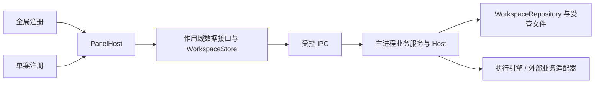

# 架构与实现基线

> 当前技术参考；需求以 [需求索引](../../REQUIREMENTS.md) 及其模块细则为准，状态与待办见 [实施计划](../../EXEC_PLAN.md)。代码路径相对仓库根目录。

## 1. 产品目标

专利工作台是独立安装的 Electron + React + TypeScript 桌面应用，覆盖以下业务：

- 案件管理与贝思兰德个人案件同步。
- 审查意见答复和补正。
- 从技术交底开始的专利撰写。
- 用户可选的独立稿件审查。
- 贝思兰德表单保存和内部转交。
- 材料、任务、对话、稿件、成果与历史版本的本地管理。

应用自主拥有案件界面和业务流程，后台 Agent 通过结构化接口执行模型任务。固定导入、整理、下载、服务端读写与模型分析分别管理。

同一案件只有一个当前办理阶段。历史阶段可以查看，不能与当前阶段同时开工；多案并行不等于同案多业务并行。

保存、内部转交和官方递交是不同的业务事实。真实写操作、真实模型质量和安装行为均需单独证据。

## 2. 当前实现基线

### 2.1 源码与安装制品

| 对象 | 依据与边界 |
| --- | --- |
| 当前源码 | 以 `package.json` 和 `package-lock.json` 的一致版本为准 |
| 制品打包范围 | 三项制品及保留的旧包以实际目录、摘要和实施计划为准，不用历史数量描述当前目录 |
| 现有安装制品 | 以 `release/release-manifest.json` 的版本、构建时间和摘要为准 |
| 版本升级 | 新增功能增加第二位，兼容修复增加第三位；生成新制品摘要，不修改或复用旧制品摘要 |
| 浏览器预览 | 仅用于界面与交互验证，不能替代桌面落盘、恢复、安装或真实模型验收 |

当前交付形态为 macOS `.app` / `.pkg` 和 Windows `.exe`。只修改文档不升级应用版本。

### 2.2 同步与缓存

以下依据 `desktop/main.ts`、`desktop/service.ts`、`desktop/baseland.ts`、`desktop/sync-cache.ts` 和 `desktop/runtime-manager.ts` 核对。参数是当前实现事实，不是独立验收结论；实现差距集中见 [当前计划](../../EXEC_PLAN.md#实现差距)。

| 项目 | 当前行为 |
| --- | --- |
| 同步范围 | 只同步分配给当前用户或由当前用户负责的案件，按案件 ID 归并流程 |
| 增量同步 | 启动、登录、选定工作目录时触发；非手动轮次有 5 分钟节流。目前失败轮次也记录节流时间，与成功口径有差距，见当前计划 D4 |
| 手动刷新 | 案件库刷新重新读取明细；刷新本案同时重判该案结论、流程和备注 |
| 定时行为 | 案件没有固定周期同步；主进程每 5 秒检查登录重试是否到期。OpenCode 另有启动及每 6 小时更新检查，运行时设置页每 2 秒读取状态，两者均不是全案同步 |
| 统计门控 | `GetPersonalProcStatistics`，窗口 15 分钟；命中时跳过明细，仍判读未出结论的案件 |
| 并发 | 个人案件五个页签并发读取；逐案处理和判读最多 4 路 |
| 递交状态缓存 | 目标为未出回执 5 分钟 / 已收到回执 60 分钟，终态分支不接受全量强制击穿；当前容器会在 5 分钟清除条目，60 分钟尚未实际生效，见当前计划 D3 |
| 结案状态缓存 | 流程键不变时，未结案复用 3 分钟、已结案最多 15 分钟 |
| 文件列表缓存 | 非当前且材料已就绪的列表复用 30 分钟；各类缓存最多 2000 项 |
| 官方结论 | 请求携带 `caseId`，最多 5 页；已出且清单完整的结论常规同步 7 天内跳过，主动重判不受此限制 |

### 2.3 办理与流转

- 答复和补正使用本案对话及五个办理步骤；撰写和审查使用专业工作台与随包技能。
- 本地案件可在本机撰写、审查和管理成果；关联当前账号的贝思兰德案件并取得可办理流程后才可内部转交。`internalTransferAvailable` 明确要求 source 为 baseland；本地办理不等于贝思兰德内部流转。
- 补正条目在提交页“本次材料”编辑，本机草稿保存于本案 `04_内部说明/transfer-*.json`。
- 流转状态为 `draft`、`saved`、`uncertain`、`submitted`、`superseded`。撤销保存后，不因远端仍有文件而自动恢复为已保存。
- 首次远端写入后失败进入 `uncertain`；允许回读后返回草稿整理。已发出转交请求但未确认结果时，必须先刷新核对，不能直接重复转交。
- 清空远端材料需要当前节点编辑权限和用户确认；HTTP 成功不等于内部转交或官方递交成功。
- 公式使用离线 KaTeX；Word 导出将 LaTeX 转为 OMML，模板从 `resources/document-templates/` 加载并核对摘要。模板版式是否通过另行验收。

## 3. 进程和模块结构

### 3.1 进程边界

| 层 | 责任 | 不应承担的责任 |
| --- | --- | --- |
| React 渲染层 | 页面、交互、展示状态、用户确认 | 读取密钥、直接访问文件系统或远端 API |
| preload | 最小结构化桥接、事件订阅、请求转发 | 业务规则、凭证处理、路径授权 |
| Electron 主进程 | 账号、文件、同步、模型、服务端读写、任务恢复 | 把临时 UI 状态当作业务事实 |
| 领域层 | 状态机、业务规则、纯数据变换、校验 | Electron、HTTP、密钥、窗口或文件系统 |
| 外部适配器 | 贝思兰德、模型协议、MCP、文档转换 | 绕过主进程授权或直接修改 UI 状态 |

### 3.2 业务模块

| 业务域 | 当前入口 | 主要数据 |
| --- | --- | --- |
| 案件管理 | `DesktopService`、`Library`、`CaseSpace` | 身份、当前阶段、期限、标签、官方结论 |
| 答复与补正 | `AgentHost`、`AgentWorkbench`、`AgentAPI` | 材料、分析、策略、稿件、复核、定稿 |
| 撰写与独立审查 | `ProfessionalHost`、`ProfessionalWork`、`ProfessionalAPI` | 撰写确认、指定版本、来源、审查报告 |
| 内部流转 | `TransferHost`、`InternalTransfer`、`TransferAPI` | 文件、表单、接收人、保存、转交、回读 |
| 模型运行时 | `ModelService`、`ModelAPI` | 供应商、协议、模型、推理级别、运行快照 |
| 桌面能力 | `ApplicationAPI`、文档工具、扩展 | 登录启动、工具权限、MCP、技能、转换器 |

## 4. 模块装配与数据路径

全局和单案在 `src/modules/builtin.ts`、`custom.ts` 分别声明，`panels.ts` 合并校验。PanelHost 按定义加载组件，缓存代码、清理订阅并在范围变化时重建视图。缓存不保留旧案件数据；注册面板不会新增办理阶段或自动获得后台写入权限。

| 概念 | 与其他概念的区别 |
| --- | --- |
| 案件 | 业务与文件身份；可包含多个历史流程，只选一个当前办理 |
| 办理阶段 / 远端流程 | `current` / processId；与撰写内部的五类步骤不同 |
| 轮次 | 通知、答复及历史稿件归属，不是全局页面 |
| 面板 | 界面入口；global / case 分别注册，不等于 WorkKind |
| 讨论与分支 | 公开消息与用户选择的路径；切换分支不回滚案件文件 |
| 任务 | 一次明确执行，有 runId、状态、冻结输入、产物及回执 |
| 后台会话 | 引擎执行记录，按账号 / 案件 / 阶段 / 讨论 / 分支 / 上下文隔离；一个案件可有多个隔离会话 |

存储沿用现有格式：主进程仓储为权威，Store 处理有序快照及保存队列，模块接口提供范围内的冻结投影。`workspace-store.ts` 仅保留浏览器预览辅助，不是桌面第二个持久化主记录。数据详情见 [数据与安全](data-security.md)，模块扩展见 [接入指南](../development/module-guide.md)。

## 5. 模型运行时与扩展

生产引擎为 OpenCode v2，通过公开结构化 API 接入。运行时自动兼容更新、后台会话、供应商缓存、上下文压缩和任务文件保存分别管理，详见 [Agent 与运行时](agent-runtime.md)。应用整体仍通过安装包更新。

执行引擎、业务客户端和仓储有合同及注册入口，但第二个真实引擎或业务系统尚未验收。外部业务合同版本 1 保留现有标准行与内部流转语义；新供应商须完成映射，不能只声明类型。运行中的任务保持其依赖，适配器替换作用于装配或后续任务。
